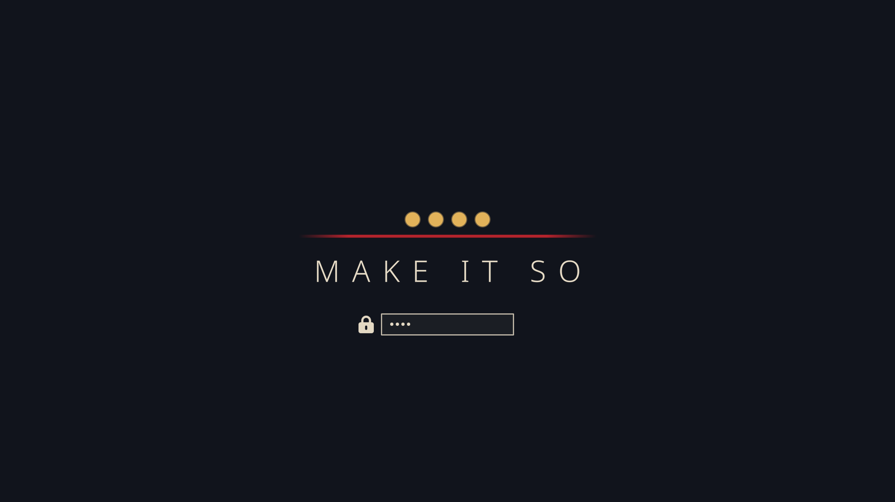

# Make It So

*An [Omarchy](https://omarchy.org) theme after Captain Jean-Luc Picard: and the future he lived.*


> *"The acquisition of wealth is no longer the driving force in our lives. We work to better
> ourselves and the rest of humanity."*

A calm deep-space ground, Earl Grey parchment text, and one unambiguous signal: the crimson of a
captain's command uniform, with the gold of his four pips beside it. It is meant to be
aspirational rather than nostalgic: a reminder to lead with clarity, listen before deciding, hold
to the truth, and help build the future he got to live in.

> **Unofficial fan work.** Not affiliated with, endorsed by, or sponsored by Paramount, CBS Studios
> or anyone involved in *Star Trek*. See [Disclaimer](#disclaimer).

## In honor of

**Patrick Stewart**, who gave Jean-Luc Picard his dignity, his warmth and his conscience;
**Gene Roddenberry**, who imagined a future worth working toward; and everyone who believes we
can build a better future for all humanity, and for the galaxy beyond it.

*This theme is a fan's thank-you. Neither man nor anyone connected to Star Trek has endorsed it.*

## Captain's log: installation

```bash
omarchy theme install https://github.com/wiseyoungbuck/omarchy-make-it-so-theme
omarchy theme set "Make It So"
```

Two commands, and you're on the bridge. You get the palette, the window borders, the Yaru red icons,
eight original wallpapers, hand-tuned **btop**, **shell** (bar, notifications, menus, lock) and
**keyboard lighting**, and a boot / disk-unlock screen of four pips over a crimson rule. Everything
else Omarchy themes (terminals, Hyprland, Neovim, Helix, VS Code, Chromium) is generated from
`colors.toml`.

To use the boot screen as well: `omarchy plymouth set by theme make-it-so`.



## Engage: the engine hum (optional)

Omarchy never runs code that comes with a theme, so the ship's systems are opt-in:

```bash
~/.config/omarchy/themes/make-it-so/extras/install.sh
```

| | |
|---|---|
| **Engine hum** | A two-minute seamless ambient loop, synthesized from scratch. Toggle with **Super + Alt + E**, `engine-hum`, or the delta in the bar. |
| **The bar delta** | Dims when the hum is off. Left click: a panel with an on/off switch and a volume slider. Right click: toggle. Scroll: volume. (Prefer a generic icon? `install.sh --plain-icon`.) |
| **Courtesy on the bridge** | Pauses while a media player plays (Spotify, browser tabs, mpv, VLC) and resumes after four seconds of quiet. Notification and UI sounds never interrupt it. |
| **On at login** | While this theme is active. |
| **A new view every login** | A random wallpaper each session, drawn from the theme's backgrounds and your own in `~/.config/omarchy/backgrounds/make-it-so/`. |

```text
engine-hum [on|off|toggle|status]
engine-hum volume          # print it
engine-hum volume 60       # set it; remembered, and applied live
omarchy-shell engine-hum open|close|toggle   # the bar panel
```

Needs `mpv`, `socat`, `jq` and `busctl`, all present on a stock Omarchy install. The installer
backs up `hypr/bindings.lua` and `omarchy/shell.json` before touching them and is safe to re-run.
`extras/uninstall.sh` removes everything it added.

## Wallpapers

Eight originals, each named for a line worth living by:

| | |
|---|---|
| `1-seize-the-time` | a planet's limb at dawn |
| `2-things-are-only-impossible-until-they-are-not` | warp |
| `3-we-work-to-better-ourselves` | the vineyard at La Barre, at dusk |
| `4-make-it-so` | four pips and a line of command |
| `5-lets-see-whats-out-there` | a nebula opening onto deep space |
| `6-ten-forward` | the long window, stars stretched to light |
| `7-tea-earl-grey-hot` | steam rising through lamplight |
| `8-the-skys-the-limit` | a ringed giant at the edge of dawn |

## Palette

| | | |
|---|---|---|
| background `#11141c` | foreground `#e3d8c3` (Earl Grey) | accent `#e8666e` (uniform crimson, text-safe) |
| yellow `#e2b25a` (captain's pips) | orange `#e08a4f` (console amber) | green `#93ad7c` (La Barre vines) |
| cyan `#6db4c4` (sciences teal) | blue `#7f96d4` (starfield) | magenta `#b591c8` (nebula) |

Bright variants lean toward the Enterprise-D interior: salmon, peach-gold, periwinkle and
lavender. Every text colour meets WCAG AA (4.5:1) against the background, and the tests check it.

## Engineering

```bash
tests/run.sh            # everything
tests/run.sh hum        # just the engine-hum tests
```

The tests cover the palette (keys, contrast, signature colours), the wallpapers and boot art, the
hand-tuned app files, the hum (on/off, volume, pausing for music but not for sound effects, quick
off/on), the login hooks, the bar icon's shape and rendering, the installer round-trip, and these
disclaimers. Tests that need a live desktop (audio, D-Bus) skip themselves elsewhere, and test
hums play at volume 0.

All the artwork is generated by code rather than drawn or downloaded:

```bash
uv run --with numpy --with pillow python tools/make_bgs.py backgrounds/   # wallpapers
uv run --with numpy python tools/make_hum.py extras/share/engine-hum.flac # engine hum
uv run --with pillow python tools/make_unlock.py                          # boot / unlock logo
uv run --with pillow python tools/make_preview.py                         # preview.png
omarchy plymouth preview "#11141c" "#e3d8c3" unlock.png preview-unlock.png
```

## Contributing

Issues and pull requests are welcome. Because this is fan work, please keep everything you add
original: no screenshots, stills, promotional images, show audio, official fonts or logos. The
tests reject image, audio and video files outside the generated set. Run `tests/run.sh` before
opening a pull request.

## Disclaimer

**This is an unofficial, non-commercial fan project.** It is not affiliated with, authorized,
sponsored, licensed or endorsed by Paramount Global, CBS Studios Inc., Paramount Pictures, or any
of the cast, crew or creators of *Star Trek*.

- **Trademarks.** *Star Trek*, *Star Trek: The Next Generation*, *Star Trek: Picard*, Jean-Luc
  Picard, Starfleet, the U.S.S. *Enterprise*, LCARS, and the Starfleet delta insignia, along with
  all related names, characters, marks and logos, are trademarks of **CBS Studios Inc.**, a
  Paramount company. They are used here only to describe what inspired this theme. No claim of
  ownership is made, and no affiliation is implied.
- **Copyright in *Star Trek*.** *Star Trek* and all of its episodes, characters, dialogue and
  imagery are © **CBS Studios Inc.** (Paramount). The short lines of dialogue quoted in this
  README, the wallpaper names and `colors.toml` are quoted for commentary, as fan tribute.
- **Nothing from the shows is distributed here.** The repository contains no screenshots, stills,
  promotional photos, logos-as-artwork, sound effects or audio from *Star Trek*. The wallpapers,
  boot art, engine hum and previews are original works generated by the scripts in `tools/`. If
  you add *Star Trek* images to your own backgrounds folder, those stay on your machine; please
  don't redistribute them.
- **The bar and notification icon** is a single-colour outline of the Starfleet delta, traced from
  the *Star Trek* icon in [Simple Icons](https://simpleicons.org) (CC0). The CC0 dedication covers
  that drawing; the insignia it depicts remains a CBS Studios trademark, used here non-commercially
  as fan tribute. It is optional: `extras/install.sh --plain-icon` swaps it for a generic rocket
  glyph.
- **No endorsement** by Patrick Stewart, the Roddenberry estate, or any other performer or creator
  is stated or implied. The dedication above is a fan's tribute.

If you represent a rights holder and would like something changed or removed, please open an
issue, and it will be addressed promptly.

## License

The theme's own work (its code, palette, generated wallpapers and boot art, synthesized audio and
documentation) is © 2026 **wiseyoungbuck** and released under the [MIT License](LICENSE). That
license covers only this original work. It grants no rights in *Star Trek* or any third-party
trademark or copyright described above.
