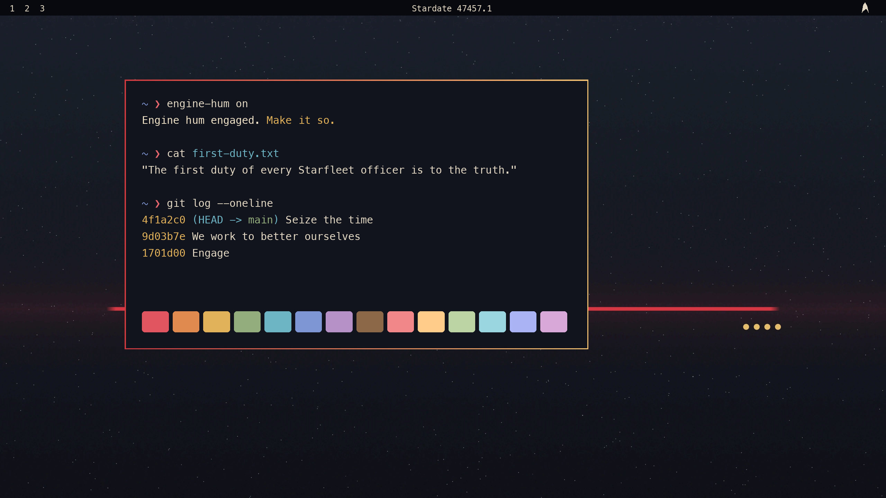

# Make It So

*An [Omarchy](https://omarchy.org) theme after Captain Jean-Luc Picard: and the future he lived.*



> *"The acquisition of wealth is no longer the driving force in our lives. We work to better ourselves and the rest of humanity."*

A calm deep-space ground, Earl Grey parchment text, and one unambiguous signal: the crimson of a
captain's command uniform, with the gold of his four pips beside it. The theme is meant to be
aspirational, not nostalgic: a reminder to lead with clarity, listen before deciding, hold to the
truth, and help build the future he got to live in.

> **Unofficial fan work.** Not affiliated with, endorsed by, or sponsored by Paramount, CBS Studios
> or anyone involved in *Star Trek*. See [Disclaimer](#disclaimer).

## Install

```bash
omarchy theme install https://github.com/wiseyoungbuck/omarchy-make-it-so-theme
omarchy theme set "Make It So"
```

That gives you the palette, window borders, icon theme and four original wallpapers. Everything
Omarchy themes (terminals, Hyprland, the bar, Neovim, btop, and the rest) is generated from
`colors.toml`.

## The extras: engine hum, bar delta, login touches (optional)

Omarchy never runs code that comes with a theme, so these are opt-in. After installing the theme:

```bash
~/.config/omarchy/themes/make-it-so/extras/install.sh
```

| What | How |
|---|---|
| **Engine hum**: a 2-minute seamless ambient loop, synthesized from scratch | `engine-hum`, **Super + Alt + E**, or the delta in the bar |
| **Bar delta**: dims when the hum is off | left click: panel with on/off switch and volume slider · right click: toggle · scroll: volume |
| **Steps aside for music**: pauses while a media player is playing (Spotify, browser tabs, mpv, VLC), resumes after 4 s of quiet; notification and UI sounds are ignored | automatic |
| **On at login** while this theme is active | automatic |
| **A random wallpaper at every login** while this theme is active, drawn from the theme's backgrounds and your own in `~/.config/omarchy/backgrounds/make-it-so/` | automatic |

```text
engine-hum [on|off|toggle|status]
engine-hum volume          # print it
engine-hum volume 60       # set it; remembered, and applied live
omarchy-shell engine-hum open|close|toggle   # the bar panel
```

Needs `mpv`, `socat`, `jq` and `busctl` (all present on a stock Omarchy install). The installer
backs up `hypr/bindings.lua` and `omarchy/shell.json` before touching them and is safe to re-run.
Remove everything it added with `extras/uninstall.sh`.

## Palette

| | | |
|---|---|---|
| background `#11141c` | foreground `#e3d8c3` (Earl Grey) | accent `#e8666e` (uniform crimson, text-safe) |
| yellow `#e2b25a` (captain's pips) | orange `#e08a4f` (console amber) | green `#93ad7c` (La Barre vines) |
| cyan `#6db4c4` (sciences teal) | blue `#7f96d4` (starfield) | magenta `#b591c8` (nebula) |

Bright variants lean toward the Enterprise-D interior: LCARS salmon, peach-gold, periwinkle and
lavender. Every text colour meets WCAG AA (4.5:1) against the background; the test suite checks it.

## Tests

```bash
tests/run.sh            # everything
tests/run.sh hum        # just the engine-hum tests
```

Covers the palette (keys, contrast, signature colours), the wallpapers, the hum (on/off, volume,
pausing for music but not for sound effects, quick off/on), the login hooks, the bar icon's shape
and rendering, and the installer/uninstaller round-trip. Tests that need a live desktop session
(audio, D-Bus) skip themselves elsewhere. Test hums play at volume 0.

## Rebuilding the art

All artwork is generated, not drawn or downloaded:

```bash
uv run --with numpy --with pillow python tools/make_bgs.py backgrounds/   # wallpapers
uv run --with numpy python tools/make_hum.py extras/share/engine-hum.flac # engine hum
uv run --with pillow python tools/make_preview.py                         # preview.png
```

## Disclaimer

**This is an unofficial, non-commercial fan project.** It is not affiliated with, authorized,
sponsored, licensed or endorsed by Paramount Global, CBS Studios Inc., Paramount Pictures, or any
of the cast, crew or creators of *Star Trek*.

- **Trademarks.** *Star Trek*, *Star Trek: The Next Generation*, *Star Trek: Picard*, Jean-Luc
  Picard, Starfleet, the U.S.S. *Enterprise*, LCARS, and the Starfleet delta insignia, along with
  all related names, characters, marks and logos, are trademarks of **CBS Studios Inc.**, a
  Paramount company. They are used here only to describe what inspired this theme. No claim of
  ownership is made, and no affiliation is implied.
- **Copyright in *Star Trek*.** *Star Trek* and all of its episodes, characters, dialogue and
  imagery are © **CBS Studios Inc.** (Paramount). The short lines of dialogue quoted in this
  README and in `colors.toml` are attributed to their episodes and quoted for commentary, as fan
  tribute.
- **Nothing from the shows is distributed here.** The repository contains no screenshots, stills,
  promotional photos, logos-as-artwork, sound effects or audio from *Star Trek*. The wallpapers,
  the engine hum and the preview are original works generated by the scripts in `tools/`. If you
  add *Star Trek* images to your own backgrounds folder, those stay on your machine; please don't
  redistribute them.
- **The bar icon** is a single-colour outline of the Starfleet delta, traced from the *Star Trek*
  icon in [Simple Icons](https://simpleicons.org) (CC0). The CC0 dedication covers that drawing;
  the insignia it depicts remains a CBS Studios trademark, used here non-commercially as fan
  tribute.
- **No endorsement** by Patrick Stewart or any other performer is stated or implied.

If you represent a rights holder and would like something changed or removed, please open an
issue, and it will be addressed promptly.

## License

The theme's own work (its code, palette, generated wallpapers, synthesized audio and
documentation) is © 2026 **wiseyoungbuck** and released under the [MIT License](LICENSE). That
license covers only this original work. It grants no rights in *Star Trek* or any third-party
trademark or copyright described above.
